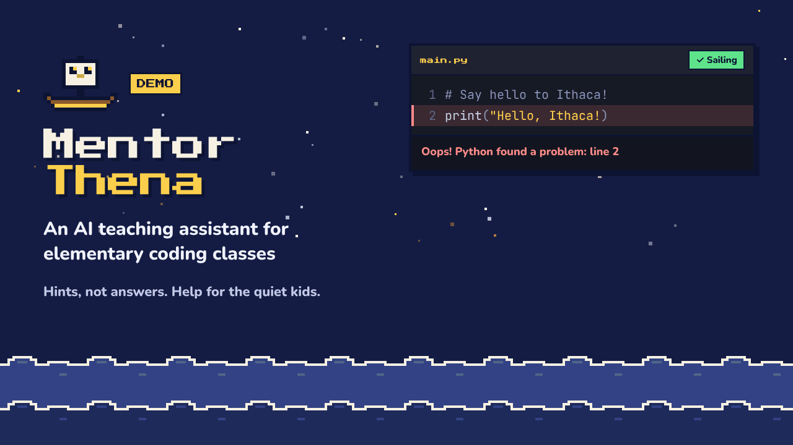
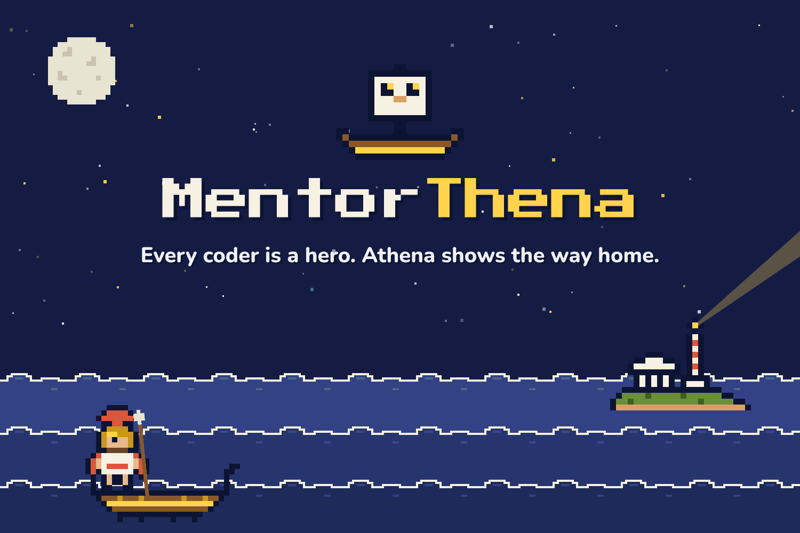
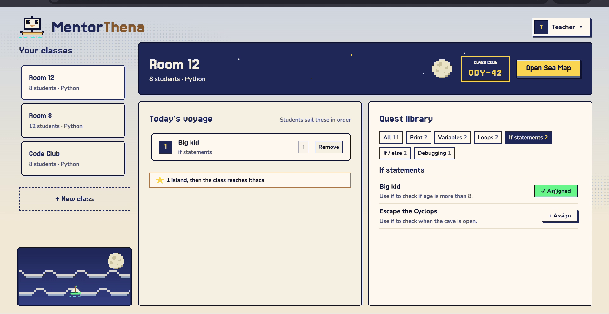
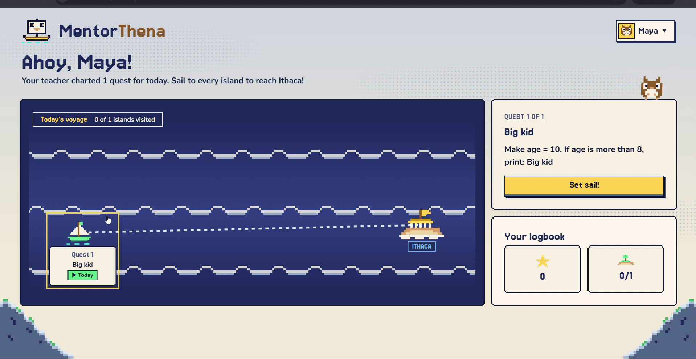
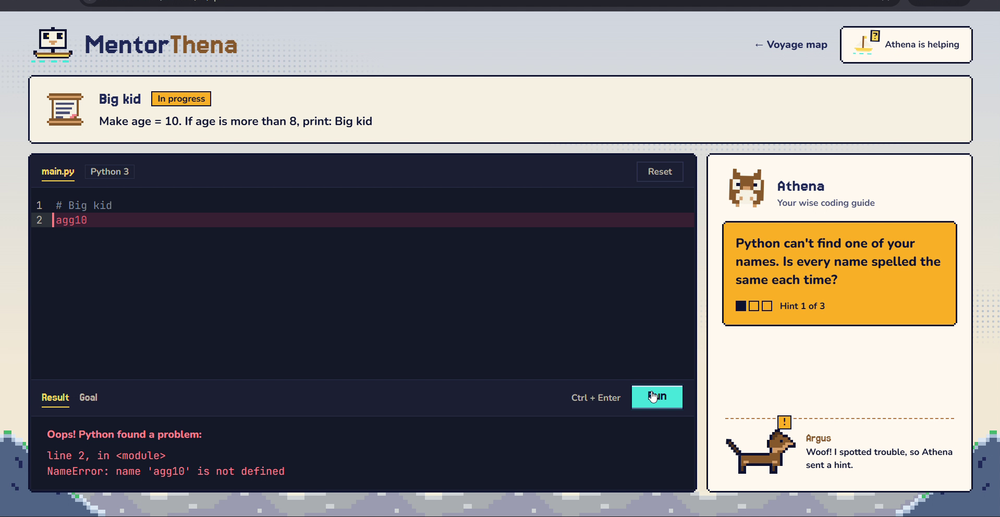
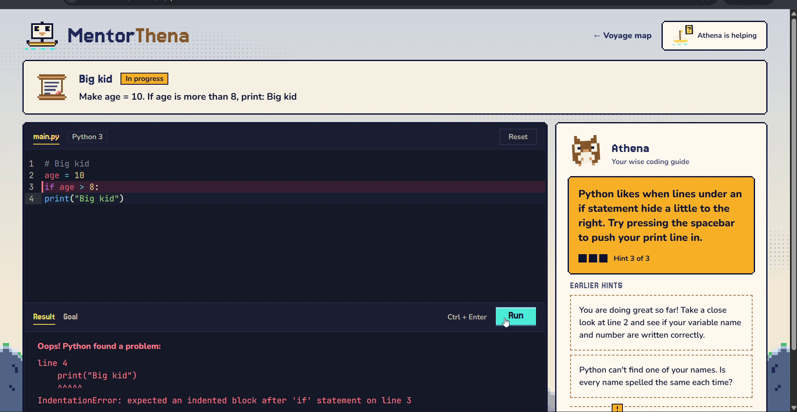
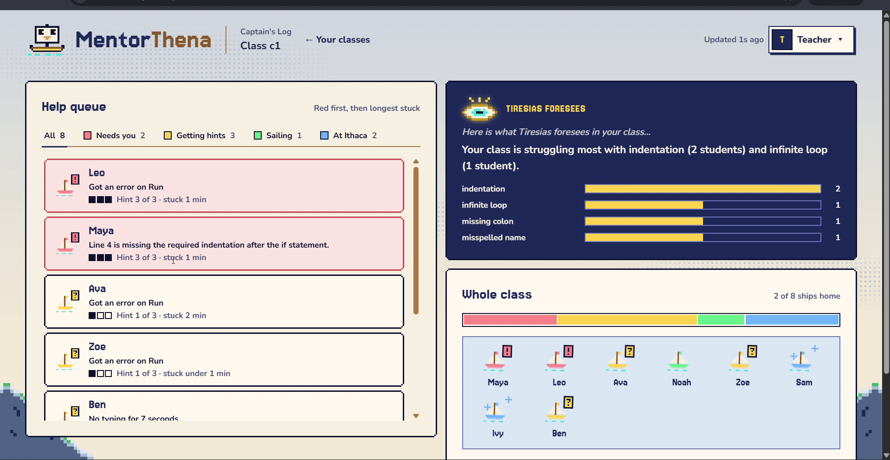
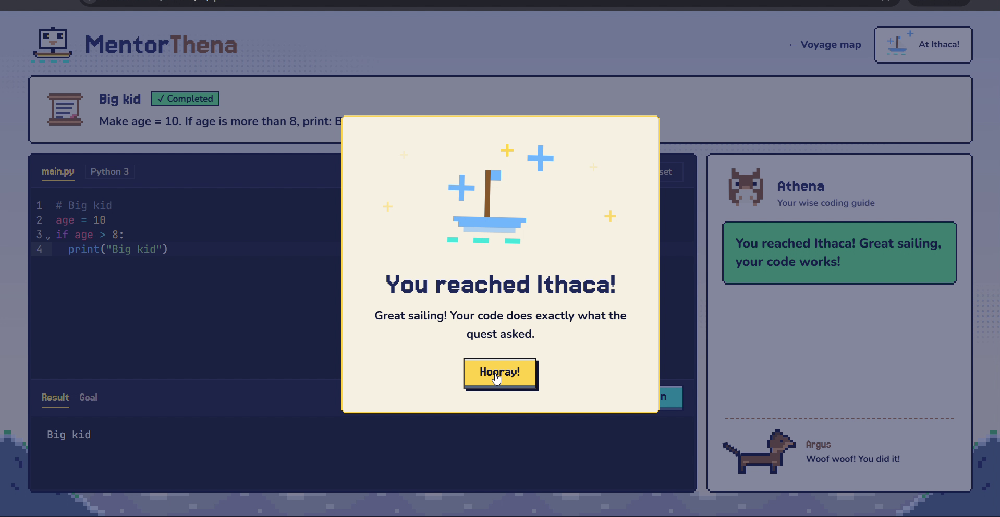
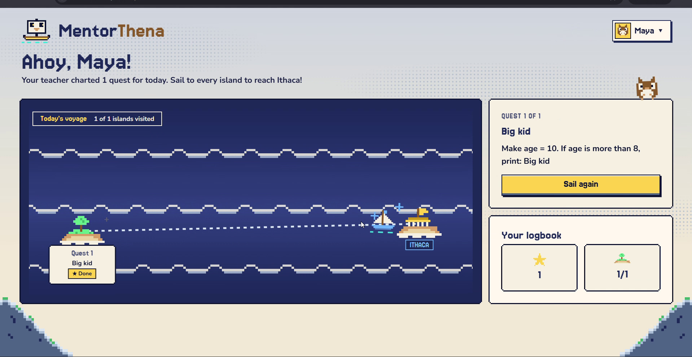

# MentorThena

**An AI teaching assistant for elementary coding classes (ages 8–10).**
It notices when a student is stuck, gives a kid-level hint (never the answer),
and shows the teacher who needs help and why.



Built with React + Vite, Flask, the Gemini API and MongoDB Atlas.


## Why MentorThena?

In a class of 25 beginners, one teacher can't watch every screen. Young or shy kids often
don't ask for help. They sit stuck and silent, waiting their turn.

MentorThena acts first:

- **It notices.** Simple rules spot a stuck kid: an error, a wrong output, no typing, or typing and deleting over and over.
- **It hints, never tells.** Hints get more specific one step at a time (a question → where to look → a tiny example), and a checker blocks any hint that gives the answer away.
- **It tells the teacher.** A live dashboard puts the kids who need the teacher first, with the reason in plain words.
- **It sees the whole class.** When many kids share the same mistake, it suggests a 1-minute mini lesson.
- **It learns.** Hints that helped one kid are remembered and reused for a similar bug.


## The Odyssey theme

The whole app is built around Homer's *Odyssey*: the story of Odysseus sailing home to the island of Ithaca.

**The name.** In the Odyssey, the goddess Athena disguises herself as an old friend called
Mentor to guide Odysseus's son. She gives advice and courage, but never fights his battles for him.
That is exactly the job of a good coding helper: **MentorThena = Mentor + Athena.**

**The voyage.** Every student is a ship. Today's quests are islands on the route, and finishing
a quest means the ship docks at **Ithaca**, home. The teacher is the captain watching the whole fleet
on the **Sea Map**.

| Ship color | Meaning |
|---|---|
| 🟢 Green | Sailing fine |
| 🟡 Yellow | Stuck: Athena is giving hints |
| 🔴 Red | Still stuck after 3 hints: the teacher is needed (only the teacher sees red) |
| 🔵 Ithaca | Task done, the ship is home |




## What the backend folders mean

Each main part of the backend is named after a character or object from the Odyssey that does the same job.

| Folder | From the Odyssey | What it does in MentorThena |
|---|---|---|
| `argus/` | **Argus**, Odysseus's loyal dog, who watched and waited for him for 20 years | **Watches every student.** Plain rules (no AI) decide when a kid is stuck: same error, wrong output, idle, or typing and deleting a lot |
| `athena/` | **Athena**, goddess of wisdom, who guides heroes with advice | **Writes the hint.** Gemini writes a kid-level hint at level 1, 2 or 3. If Gemini is slow or down, a hand-written backup hint is used |
| `athena/siren_guard.py` | **The Sirens**, whose song tempts sailors. Odysseus had himself tied to the mast to resist them | **Siren Guard.** Checks every hint before the kid sees it and rewrites any hint that gives the answer away |
| `ships_log/` | **The Ship's Log**, the record of a voyage | **Memory.** Saves hints that helped and finds them again for a similar bug with Atlas Vector Search |
| `tiresias/` | **Tiresias**, the blind prophet who tells Odysseus what lies ahead | **Class insight.** Counts stuck kids by mistake type and tells the teacher the class's weak spot |
| `seamap/` | **The sea** and the ships sailing on it | **Sea Map.** Data for the teacher dashboard: every student's ship, color, reason and hint level |

The frontend keeps the theme too: kids see **Athena** as an owl giving hints and **Argus** as a dog
who wakes up when he spots trouble.


## Demo

▶ **Demo video:** `mentorthena_demo_FINAL.mp4`

### 1. The teacher plans today's voyage

*The teacher picks a class (Room 12, class code ODY-42) and assigns the "Big kid" quest from the quest library. Students sail the quests in order, then reach Ithaca.*

### 2. The student sees their voyage

*"Ahoy, Maya!" Each quest is an island on the route to Ithaca. Maya presses **Set sail!** to open the quest.*

### 3. Athena's hints get more specific
| Hint 1: a nudge | Hint 3: the idea in kid words |
|---|---|
|  |  |
| *Maya typed `agg10` and got a NameError. Argus spots it and Athena asks a question: "Is every name spelled the same each time?"* | *Now the print line isn't pushed in. By hint 3, Athena explains the idea ("lines under an if hide a little to the right"). Earlier hints stay underneath.* |

### 4. The Sea Map: who needs help and why

*The help queue puts red ships first (all 3 hints used), each with the reason and the time stuck. Tiresias shows what the class struggles with most (here: indentation), and the whole class shows as ships.*

### 5. Reaching Ithaca
| Task complete | Ship docks home |
|---|---|
|  |  |
| *The code prints the right output, so the ship reaches Ithaca. The hint that helped is saved to the Ship's Log.* | *Back on the voyage map, the island is done, the ship is home and Maya earns a star.* |


## How it works

```
Student writes code ─► Python runs in the browser (Pyodide)
        │
        ▼  on every Run, and a heartbeat every 10 s
Argus checks the rules ──► not stuck: ship stays green
        │
        ▼  stuck
Ship's Log looks for a hint that helped before
Athena writes a hint (Gemini, or a backup hint)
Siren Guard checks the hint doesn't give the answer away
        │
        ▼
Kid sees the hint (yellow) ─► after hint 3: red, the teacher is needed
        │
        ▼  right output
Ship docks at Ithaca, and the helpful hint is saved to the Ship's Log

Teacher's Sea Map refreshes every 3 s; Tiresias sums up the whole class
```


## Tech stack

| Part | Tools |
|---|---|
| Frontend | React 19, Vite, React Router, CodeMirror, Pyodide (Python in a Web Worker), plain CSS with a pixel-art theme |
| Backend | Python, Flask, pymongo |
| AI | Gemini API: `gemini-3.5-flash-lite` for hints, Siren Guard and Tiresias; `gemini-embedding-2` for the Ship's Log |
| Database | MongoDB Atlas: documents, Atlas Vector Search, a TTL index (snapshots deleted after 7 days), aggregation |


## Run locally

### What you need
- Python 3.11 or newer
- Node.js 20.19 or newer (Vite needs it)
- A MongoDB Atlas cluster (the free M0 tier works) and its connection string
- A Gemini API key from Google AI Studio

### 1. Backend

```bash
cd backend
python -m venv venv
venv\Scripts\activate          # Windows
# source venv/bin/activate     # macOS / Linux
pip install -r requirements.txt
copy .env.example .env         # then fill in your keys (cp on macOS / Linux)
```

Fill in `backend/.env`:

| Key | Value |
|---|---|
| `MONGODB_URI` | your Atlas connection string |
| `MONGODB_DB` | `mentorthena` |
| `GEMINI_API_KEY` | your Gemini key |
| `USE_GEMINI` | `1` for real AI hints. `0` uses only the backup hints and makes zero Gemini requests (good for UI work) |

Set up the database once, then start the server:

```bash
python create_indexes.py       # indexes, including the vector search index
python seed_ships_log.py       # optional: starting memories for the Ship's Log (needs USE_GEMINI=1)
python app.py                  # Flask API on http://localhost:5000
```

In a second terminal (with the venv on), fill the demo class and start the bot students:

```bash
cd backend
python seed_demo.py            # class c1, 4 quests, 8 students; bots move every 10 s (Ctrl+C to stop)
```

### 2. Frontend

```bash
cd frontend
npm ci                         # installs exactly what package-lock.json lists
npm run dev                    # http://localhost:5173
```

### 3. Open the app

| Page | URL |
|---|---|
| Log in | http://localhost:5173/ |
| Teacher home (assign quests) | http://localhost:5173/teacher |
| Sea Map for class c1 | http://localhost:5173/teacher/c1 |
| Student voyage (Maya, `s1`) | http://localhost:5173/student/s1 |

Demo order: on the teacher home, assign **Big kid** to Room 12 and open the Sea Map. Then log in as a
student, press **Set sail!**, and write some buggy code to see Athena's hints.

To reset every ship before another run: `curl -X POST http://localhost:5000/api/demo/reset`.
All backend commands and curl tests are in [backend/RUNNING.md](backend/RUNNING.md).


## Project layout

```
backend/
  app.py            Flask API routes
  config.py         stuck rules, hint limits, model names
  argus/            stuck detection
  athena/           hints, backup hints, Siren Guard
  ships_log/        memory of hints that helped
  tiresias/         class insight for the teacher
  seamap/           Sea Map, status, task, demo reset
  seed_demo.py      demo class + bot students
frontend/
  src/pages/        log in, student voyage, quest, teacher home, Sea Map
  src/components/   Athena panel, output box, ship, celebration...
  public/pixel/     pixel art
docs/
  DECISIONS.md      why things are the way they are
  screenshots/      pictures for this README
```


## Privacy and safety

- Students never see other students, and there is no open chat with the AI
- First names only
- Student code runs in the browser, never on the server
- The expected output and the teacher's solution never leave the server
- Code snapshots are deleted automatically after 7 days
- API keys stay in `backend/.env`, which is never committed


## Built for

A 24-hour hackathon. Some parts are demo-only for now: login checks nothing, and the class list
and quest library are sample data in the browser. Only class `c1` lives in the database.
